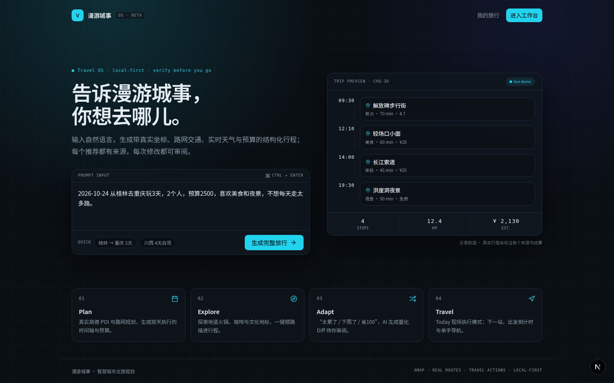
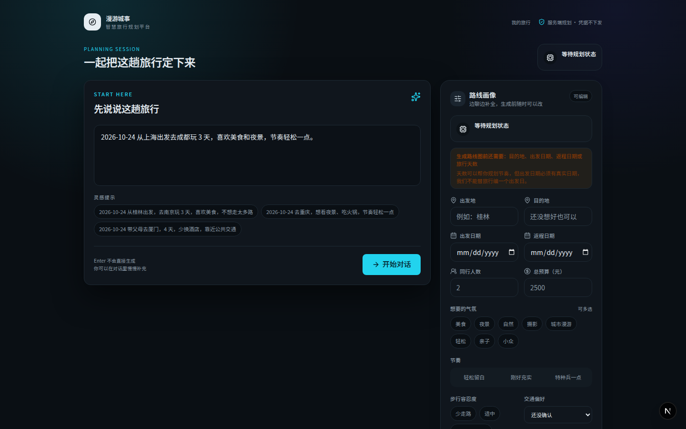
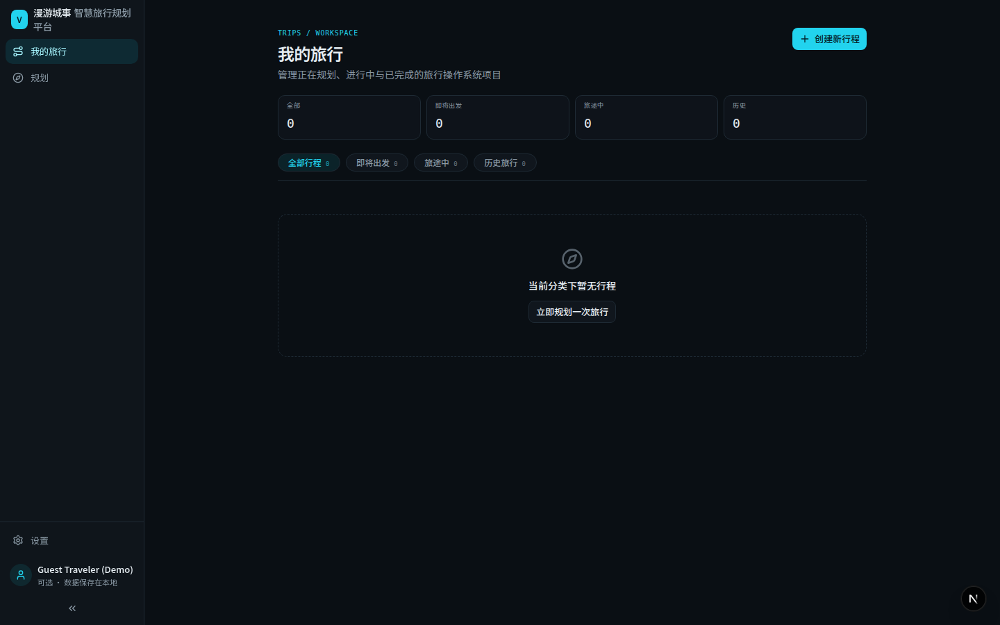
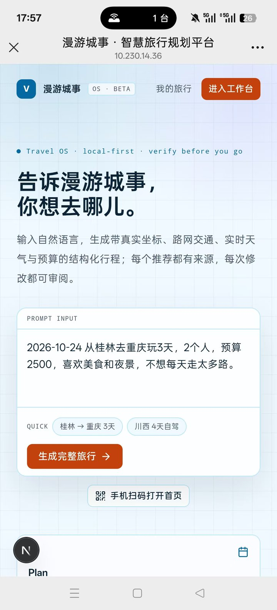
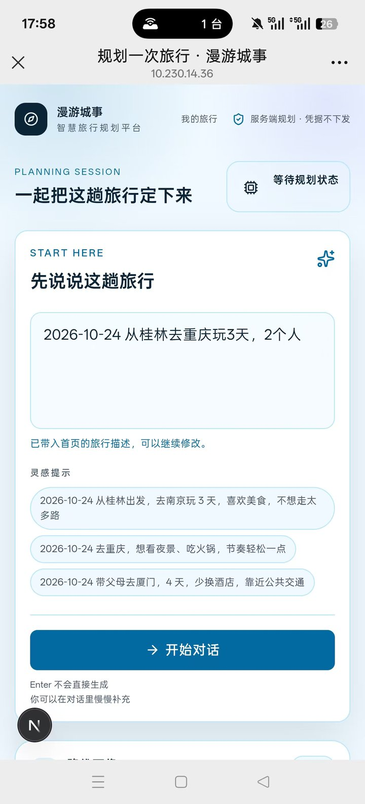
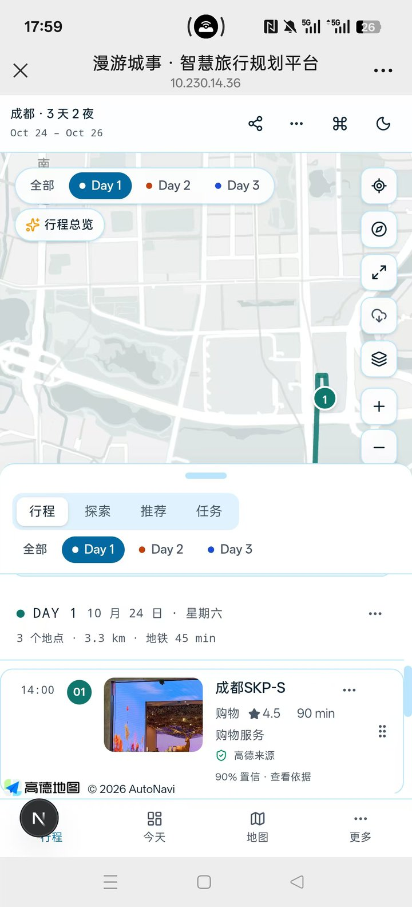

[中文](README.md) | English

# RoamCity

**An open-source, AI-native, local-first travel operating system.**

Turn one sentence of travel intent into a real itinerary that works day by day and can be changed mid-trip.
No invented places, no fabricated prices, and no auto-applied decisions.

[](LICENSE)
[](https://nextjs.org)
[](https://react.dev)



## Highlights

- **No account required** — open it and go; sign-in exists only for optional cross-device sync.
- **Local-first** — itineraries, proposals, and knowledge live in your own `.voyage/` directory, never on a RoamCity server.
- **Bring your own keys** — AMap, LLM, and social data are all BYO; with zero configuration you can still walk through the full Demo mode.
- **Real POIs, routes, and weather** — coordinates, road networks, and forecasts come from real providers; estimates are always labelled, and unknown stays unknown.
- **Guides become itineraries** — paste a Xiaohongshu / Douyin link or guide text; every place is verified before it enters the trip.
- **AI optimization** — reorder each day by geographic clustering, time windows, weather, pace, and walking tolerance, with a stated reason for every move.
- **Today execution mode** — one screen answers: next stop, how to get there, when to leave, how much walking remains, and when the day ends.
- **Propose, never auto-apply** — every change produces a quantified Diff and a one-time `proposalToken`; nothing is written back until you confirm.
- **Web + MCP + Skill** — one Runtime drives the Web Agent, an MCP server (Claude Desktop / Cursor), and external Skill packages.

## UI Preview

Screenshots below are from the current build (captured 2026-10-23).

### 1. Home · Describe your trip in one sentence

No sign-up required. Type your destination, dates, party size, and preferences to start planning.


### 2. New Trip · A travel profile forms as you chat

The dialog on the left asks for whatever is still missing while the profile panel on the right updates in sync; real routes and budgets are generated only after you confirm.



### 3. My Trips · Manage every trip in one place

Filter by All / Upcoming / Traveling / Completed, and duplicate, archive, or delete trips.



### 4. 3D Scene · An explorable Hongyadong

Open a location's 3D scene straight from the itinerary to inspect the night view and nearby landmarks before deciding to go.


### 5. Mobile · The full flow at real-device size

Bottom navigation, a half-screen itinerary drawer, and 44px touch targets are built for real devices — not a shrunken desktop layout.

<p>



</p>

## Run it in 30 seconds

```bash
git clone https://github.com/fhyfrdfd/roamcity.git
cd roamcity
npm install
npm run dev
```

Open [http://localhost:3002](http://localhost:3002).

With no environment variables, the app starts in **Demo mode**: a built-in Chongqing itinerary and vector basemap let you walk through planning, Diff confirmation, and Today mode end to end.

> Requires Node.js 20+.

## Provider Tiers: Start from Zero Config

You can experience the whole product without configuring any key. Unlock capabilities one tier at a time:

| Tier | What you need | What it unlocks |
|---|---|---|
| **Level 0 · Demo** | Nothing | `VOYAGE_DEMO_MODE=true`, a built-in Chongqing itinerary + vector basemap, the full planning / Diff / Today loop |
| **Level 1 · AMap** | `AMAP_SERVER_KEY` (+ `NEXT_PUBLIC_AMAP_KEY` for the real map) | Real POI search, real road-network routing, real weather |
| **Level 2 · LLM** | `LLM_BASE_URL` / `LLM_MODEL` / `LLM_API_KEY` | Natural-language planning chat, guide-link parsing, multi-turn Today Agent suggestions |
| **Level 3 · Social / Offers** | `TIKHUB_API_KEY` (social), `MEITUAN_HT_TOKEN` (Meituan), `FLIGGY_*` (Fliggy) | Xiaohongshu / Douyin guide fetching, popularity signals, flight and local-life offers |

When any tier is missing, RoamCity **degrades and labels it honestly** (`providerStatus`: `REAL` / `ESTIMATED` / `CURATED` / `UNAVAILABLE`…). Estimates are never disguised as real data.

## How It Works

The traveller types one sentence:

> "3 days in Chongqing from Guilin, 2 people, budget 2500, love food and night views, don't want to walk too much each day."

RoamCity produces, within seconds, a **real, structured, map-grounded, weather-aware, persistent, editable trip project**.

Mid-trip, the traveller only needs to say:

- "Tomorrow is too tiring" → fewer long climbs; walking legs switch to taxi and light rail;
- "It's raining today" → Rain Plan swaps outdoor walks for the indoor Three Gorges Museum;
- "Save 100 today" → taxis fall back to metro and the dining mix is trimmed;
- "Push it back an hour" → the whole day shifts and every transfer is recalibrated.

Every instruction is compiled into a Zod-validated structured `TravelAction`, producing a quantified comparison report (`TripChangeSet`) in a Diff review modal. **Nothing is applied until you confirm** (one-time `proposalToken`, valid for 10 minutes, resistant to replay and tampering).

## Four Pillars

| Phase | Role | Core capability |
|---|---|---|
| **1. Plan** | Itinerary and timeline generation | Real POI aggregation, geographic clustering, automatic meal / visit-duration / budget placement. |
| **2. Explore** | Real discovery and merchant search | Live AMap POI search with precise filters such as indoor, night view, free, and low walking; no fabricated ratings or empty prices. |
| **3. Adapt** | Dynamic adaptation and diff review | Global Command Bar (`Cmd+K`) quantifies walking reduction, transport swaps, and cost deltas before applying; 10-step undo. |
| **4. Travel** | On-the-ground console (Today) | Mobile-first one-handed operation: next stop, departure and arrival countdowns, one-tap navigation into the AMap app. |

## Architecture

```
UI Components (Next.js 15 App Router · React 19 · Tailwind v4 · Radix UI · Motion · dnd-kit)
      ↓
State & Control Layer (Zustand: useTripStore · useUiStore · useHistoryStore · CommandBar)
      ↓
AI Action & Diff Engine (TravelAction 3.0 · ActionPlanner · ActionExecutor · TripDiffModal)
      ↓
Travel Intelligence (Route Matrix · Transport Scoring · RAG Planning Context)
      ↓
Knowledge Engine (Hybrid Keyword + pgvector · Freshness · Confidence · Provenance)
      ↓
Service Facades & Routing Engine (RoutingService · WeatherContext · BookingIntent)
      ↓
Server Boundary (API Routes with 'server-only' secrets isolation)
  ├── AMap REST (POI Search, Geocoding, Walking/Driving/Transit Directions, Polylines)
  ├── OpenAI-compatible LLM (Chat Completions: Qwen, DeepSeek, GPT-4o)
  └── Supabase (Secure RLS bound to auth.uid() + In-Memory Fallback)
```

## Verification & Evaluation

```bash
npm run lint           # ESLint
npm run typecheck      # strict TypeScript check
npm test               # Vitest unit and integration tests (97 test files)
npm run build          # production Turbopack build
npm run test:e2e       # Playwright end-to-end tests (42 tests across 14 specs)
npm run test:e2e:smoke # smoke subset: 3D scene, conversational planning, offline fallback, mobile nav, remove-day, session resume
```

```bash
npm run bench            # deterministic behaviour benchmark, writes benchmarks/results/latest.json
npm run bench:compare    # compare against the baseline; exits 1 on regression
npm run bench:baseline   # refresh the baseline after a clean run
npm run eval:profile     # planning-profile extraction eval
npm run eval:nlu         # NLU diff eval
npm run eval:trust       # 20-case trust eval (real AMap + LLM), writes report.md
npm run bench:optimizer  # Itinerary Optimizer scheduling eval
```

> `eval:trust` calls real external services and incurs cost; methodology is documented in `benchmarks/eval/trust/README.md`.

## Environment Variables (`.env.local`)

| Variable | Purpose | Behaviour when missing |
|---|---|---|
| `NEXT_PUBLIC_AMAP_KEY` | AMap JS API key (web client) | Falls back to the SVG vector basemap |
| `NEXT_PUBLIC_AMAP_SECURITY_CODE` | AMap JS API security code | Used together with the JS key |
| `AMAP_SERVER_KEY` | AMap Web Service REST key (server) | Uses the curated real-place library and Haversine estimates |
| `LLM_BASE_URL` | OpenAI-compatible LLM base URL (e.g. Ark, DeepSeek) | Falls back to the rule engine |
| `LLM_API_KEY` | Server-side model API key | Kept server-side; never exposed to the browser |
| `LLM_MODEL` | Model name (e.g. `deepseek-v3`, `gpt-4o-mini`) | Defaults to `gpt-4o-mini` |
| `EMBEDDING_BASE_URL` | OpenAI-compatible embeddings base URL | RAG falls back to keyword / local knowledge retrieval |
| `EMBEDDING_API_KEY` | Embeddings API key | Server-side only |
| `EMBEDDING_MODEL` | 1536-dimension embedding model | No semantic vector search |
| `NEXT_PUBLIC_SUPABASE_URL` | Supabase project URL | Runs silently in in-memory Demo mode |
| `NEXT_PUBLIC_SUPABASE_ANON_KEY` | Supabase anon key | Governed by `0002_rls_secure.sql` row-level security |
| `TIKHUB_API_KEY` | TikHub social search (Xiaohongshu / Douyin / Weibo / WeChat) | Social evidence is shown as unavailable |
| `VOYAGE_GUEST_TTL_DAYS` | Guest workspace expiry in days | `30` by default; `0` disables cleanup |

## Feature Highlights

- **Agent-led guidance + visible tool calls**: the Today page proactively offers clickable next-step suggestions based on trip facts (upcoming rain, empty days, over budget, overly long walks, unchecked quotes, pre-trip to-dos); the Agent calls real tools (AMap POI / routes / weather / social evidence / quotes) and shows the call trace as badges in the reply card. The LLM can only propose — applying requires your confirmation in the Diff.
- **Itinerary Optimizer v1**: geographic clustering, intra-day nearest-neighbour chains, time windows (night views in the evening, meals anchored to meal times), user profile (pace, walking tolerance, elderly / children), and rain-aware indoor priority; `decisions[]` explains every adjustment, and facts that cannot be scheduled are recorded honestly in `unresolvedConstraints`.
- **Multi-turn follow-ups**: Today-page AI adjustments carry the last 8 turns of context, so follow-ups like "a bit less" or "switch it to the afternoon" work directly.
- **One-tap guide import (Xiaohongshu / Douyin / WeChat)**: paste a link (short links work) into the planning dialog; the body is fetched, every place is verified against AMap, stops are laid into each day in the original order and drawn on the map, and a checklist is generated.
- **Single-day focus**: only the selected day's list and routes are shown; "All" switches back to the whole trip.
- **Full mobile navigation**: bottom navigation for Itinerary / Today / Map / More, a visible share button on mobile, and a global bottom bar on non-trip pages (My Trips / Settings).
- **Recoverable planning sessions**: the session ID is persisted locally and the conversation is stored server-side; "continue last planning" restores it, and expired sessions are reported and cleaned up.
- **Operational hardening**: paid endpoints (AMap / TikHub / LLM / Fliggy / planning) are rate-limited per caller with 429 + Retry-After; structured JSON logs cover degradation and failure paths; guest workspaces expire by TTL.

## Docs

- [`docs/CURRENT_ARCHITECTURE.md`](docs/CURRENT_ARCHITECTURE.md) — current architecture and module boundaries
- [`docs/GOLDEN_TRIP.md`](docs/GOLDEN_TRIP.md) — Guilin ↔ Chongqing 3-day/2-night golden acceptance baseline
- [`docs/REAL_WORLD_PROVIDER_GUIDE.md`](docs/REAL_WORLD_PROVIDER_GUIDE.md) — AMap / weather / booking / Supabase integration guide
- [`docs/TRAVEL_ACTIONS.md`](docs/TRAVEL_ACTIONS.md) — TravelAction spec and Diff preview
- [`docs/RUNTIME_COMMAND_EXPOSURE.md`](docs/RUNTIME_COMMAND_EXPOSURE.md) — Web / MCP / Skill command exposure matrix
- [`docs/PROJECT_INNOVATION.md`](docs/PROJECT_INNOVATION.md) — innovation and differentiation
- [`packages/voyage-mcp/README.md`](packages/voyage-mcp/README.md) — MCP server usage
- [`knowledge/README.md`](knowledge/README.md) — Travel Knowledge RAG format, ingestion, and retrieval

## Contact

If you run into a problem, have a suggestion, or just want to talk about the project, please open a GitHub Issue.

## License

[](LICENSE)

Released under the [MIT License](LICENSE).
